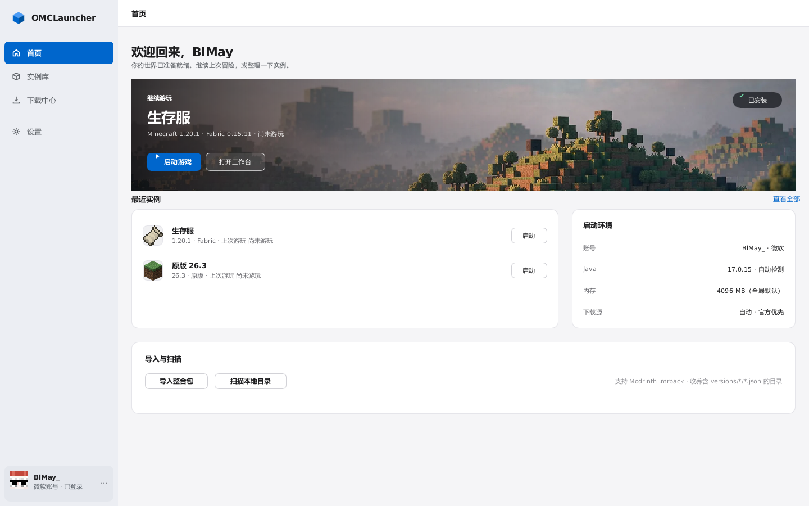
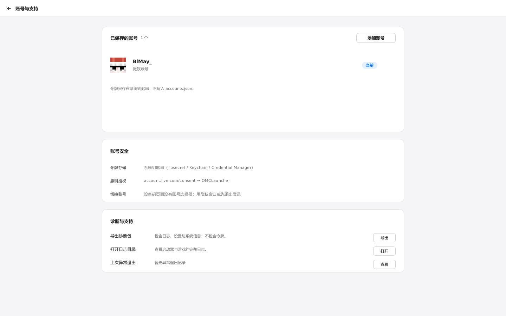

# OMCLauncher

An open-source third-party launcher for **Minecraft: Java Edition**, written in Rust with a
native Slint UI — no Electron, no bundled Java runtime, a single ~20 MiB binary on Linux.

> ⚠️ In active development. Microsoft sign-in is wired end-to-end and pending Mojang's
> AppID review ([aka.ms/mce-reviewappid](https://aka.ms/mce-reviewappid)).

## Highlights

- **Accounts** — Microsoft device-code sign-in (public client, `XboxLive.signin offline_access`),
  game-ownership check via `/entitlements/mcstore`, tokens in the OS keychain; offline accounts too.
- **Instances** — per-instance settings, loader install/switch (Vanilla / Fabric / Quilt /
  Forge / NeoForge), mod management, log viewer with crash diagnostics.
- **Downloads** — concurrent queue with resume + SHA-1 verification, content-addressed cache,
  official / BMCLAPI mirror switching, proxy support.
- **Resources** — Modrinth and CurseForge search for mods, resource packs, shaders and
  modpacks, filtered by game version, loader and environment; page-numbered results and
  version tables (20 / 8 per page); install into the selected instance or save the file
  elsewhere; update checks against an installed-index.
- **Packaging** — deb + portable tarball, covered by a 15-item smoke test.

## Screenshots

## Tech

Rust 2021 · Slint 1.x (winit + FemtoVG, software renderer built in) · reqwest/rustls · tokio

Layered crates: `mcl-core` (domain & services) → `mcl-app-model` (UI-agnostic app layer) →
`mcl-app` (Slint shell), plus `mcl-cli` for scripting and CI smoke tests.
CI enforces the layering on ubuntu / macOS / windows and runs 226 unit tests.

## Roadmap

- Optional CurseForge API key, preferring the official source when one is configured
- Dark theme (token dual values) and Chinese font subsetting
- Per-field inheritance for instance settings
- OptiFine local-import overlay

## License

GPL-3.0-only. Bundled instance icons come from HMCL (GPL-3.0-or-later), see `NOTICE`
in the source tree. The full source will be published here after the release cleanup —
this page is the project's documentation home meanwhile.
